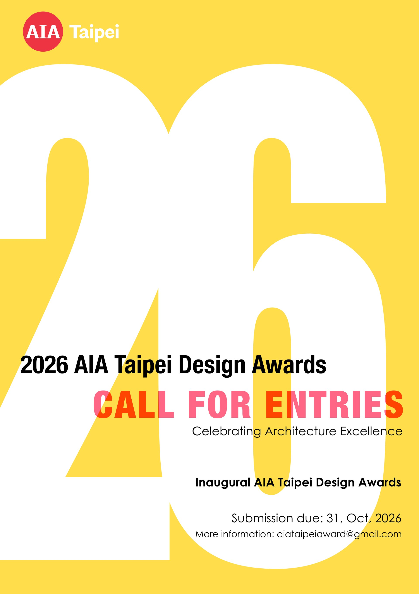

# 2026 AIA Taipei Design Awards — Call for Entries page

A single, self-contained **static HTML page**. No build step, no framework, no
server-side code. Site chrome (header / navigation / footer) has been removed
deliberately so the page can be dropped inside an existing site template.

單一檔案的**靜態網頁**，不需編譯、不需框架、不需後端。已刻意移除頁首、導覽列與頁尾，
可直接嵌入既有網站模板。

---

## 1. Contents 檔案內容

```
index.html                                          the page 網頁本體
downloads/
  2026-AIA-Taipei-AWARDS_Appendix-Forms-A-E.docx    entry forms, linked from the page
README.md                                           this file 本說明
```

That is everything the page needs. It references **no local images** — the
poster is drawn in CSS (see §4).

以上即為全部所需檔案。頁面**未使用任何本機圖檔**，海報以 CSS 繪製（見第 4 節）。

---

## 2. Deploying 上架方式

Copy both `index.html` and the `downloads/` folder to the web root, keeping
their relative positions. The download link is relative
(`downloads/2026-AIA-Taipei-AWARDS_Appendix-Forms-A-E.docx`), so the folder
must stay next to the page.

將 `index.html` 與 `downloads/` 資料夾一併複製到網站目錄，**保持相對位置**；
下載連結為相對路徑，資料夾必須與網頁放在同一層。

Serve over HTTPS. Nothing else is required.

### Embedding in a CMS 嵌入 CMS
If you are pasting into an existing template rather than serving the file
as-is, copy **the entire `<style>` block in `<head>`** together with
**everything inside `<body>`**. The two `<link>`/`<script>` tags for fonts
(see §3) should also be carried over, or the page falls back to system fonts.

若要貼進既有模板，請將 `<head>` 內的整段 `<style>` 與 `<body>` 內所有內容一起複製；
字型的 `<link>`／`<script>`（見第 3 節）也建議一併保留，否則會退回系統字型。

---

## 3. Fonts 字型

The page loads **Proxima Nova** from Adobe Typekit — the same typeface and the
same kit used on aiainternational.org — with **Hanken Grotesk** (Google Fonts)
and then Helvetica / Arial as fallbacks.

If the Typekit kit is not licensed for the destination domain, the page still
renders correctly using the fallbacks; only the typeface changes. To use a
different kit, replace the `use.typekit.net` `<script>` tag in `<head>`.

頁面透過 Adobe Typekit 載入 **Proxima Nova**（與 aiainternational.org 同一組 kit），
後備字型為 Hanken Grotesk 與 Helvetica／Arial。若目標網域未取得 Typekit 授權，
頁面仍可正常顯示，只是字型改用後備字型；如需更換，請替換 `<head>` 內的
`use.typekit.net` script 標籤。

---

## 4. Replacing the poster 更換海報

The poster at the top is currently **reproduced in CSS**, so it stays sharp at
any size and needs no image file. To use the real artwork instead:

1. Save the artwork as `assets/poster.jpg` (portrait, A4 proportions — 1:1.414).
2. In `index.html`, find the `<div class="poster" …>` block (just after
   `<!-- ============ POSTER ============ -->`) and replace the whole block with:

```html

```

The surrounding `.poster-wrap` already centres and sizes it; the supporting CSS
(`.poster img.poster-img`) is present.

目前海報以 CSS 繪製，任何尺寸都不失真。若要改用實際圖檔：存成 `assets/poster.jpg`
（直式 A4 比例 1:1.414），再將 `index.html` 中整個 `<div class="poster" …>` 區塊
替換為上方的 `` 標籤即可。

---

## 5. Editing content 修改內容

All copy is plain HTML in `<body>` — no templating. The most likely edits:

| What 項目 | Where to look 位置 |
|---|---|
| Submission deadline 截稿日 | 6 places — the poster text `.p-t5`, the poster's `aria-label`, the red badge `<div class="deadline">`, the Key Dates block `#dates`, and in `#fees` both the final fee phase (`19–31 Oct`) and the milestone row |
| Fees 費用 | the table in `#fees` |
| Contact email 聯絡信箱 | search for `aiataipeiaward@gmail.com` |
| Sponsors 贊助 | `#sponsors` — currently reads "Coming soon" |

**The deadline appears in six places.** If you change it, change all six so the
page stays consistent — including the poster's `aria-label` (screen-reader text)
and the end of the final fee phase, which is bounded by the deadline.

**截稿日共出現於六處**，修改時請一併更新（含海報的 `aria-label` 及最後一段費率的結束日），以免前後不一致。

---

## 6. Browser support 瀏覽器支援

Current Chrome, Edge, Safari and Firefox. Layout is responsive down to phone
widths; the fee table scrolls sideways inside its own box on narrow screens
rather than stretching the page.

The poster uses CSS container queries and `aspect-ratio`, both supported in all
current browsers. In a browser older than ~2023 the poster type may not scale,
but the page remains readable.

---

## 7. Accessibility 無障礙

Headings run in order, the fee table uses proper `<th scope>` and a caption,
the poster carries a text alternative, and colour contrast meets WCAG AA.
Please keep these intact when editing.
